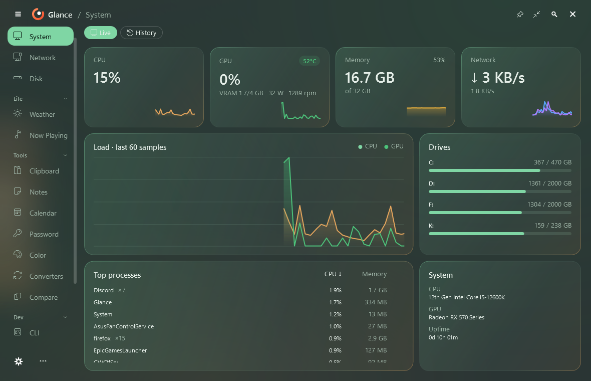

# Glance

A glassy Windows 11 tray dashboard: system stats, everyday tools and a terminal in one window.



## What's inside

- **Monitor**: live CPU, GPU, memory and network with history, a network page, disk cleanup and a disk usage scan
- **Life**: weather, map, budget, exchange rates, stocks, now playing
- **Tools**: clipboard history, notes and sticky notes, Google Calendar, password generator, color picker, image and media converters, file and folder compare
- **Dev**: a tabbed terminal (xterm.js + ConPTY), ports, Git, Docker, JSON viewer
- A Ctrl+K command palette, a mini window and a bar window, and it lives in the tray

## Install

Download `Glance-x.y.z-setup.exe` from [Releases](https://github.com/dpatrik0610/glance-releases/releases/latest) and run it (no admin needed). For a portable copy, unzip the `-win-x64.zip` instead. Glance updates itself.

Needs Windows 10/11 x64 (the glass look is best on 11), the [.NET 10 Desktop Runtime](https://dotnet.microsoft.com/download/dotnet/10.0) and WebView2.

## Build from source

```
dotnet build -c Release
```

Requires the .NET 10 SDK. Settings and notes are stored in `%APPDATA%\Glance`.

```
src/Glance/     the app
  Pages/        one page per sidebar entry
  Services/     system, network, storage and API access
  Windows/      secondary windows and dialogs
  Controls/     custom-drawn controls (gauges, sparklines, treemap)
  Themes/       styles and animations
  Terminal/     xterm.js host for the CLI page
  Map/          Leaflet host for the Map page
installer/      Inno Setup script for the setup exe
tools/          build, deploy, release and signing scripts
docs/           screenshots
```

## License

Copyright (C) 2026 dpatrik0610

Glance is free software under the [GNU General Public License v3.0](LICENSE): you can use, study, change and share it, and anything you distribute that's built on it must be released under the same license, with its source.
