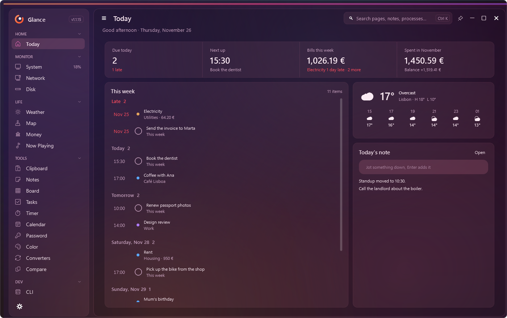
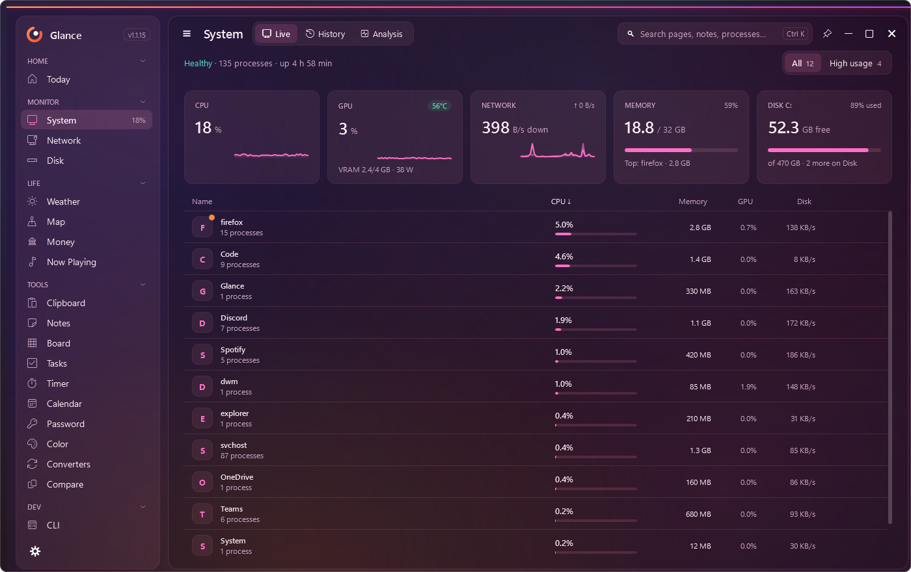
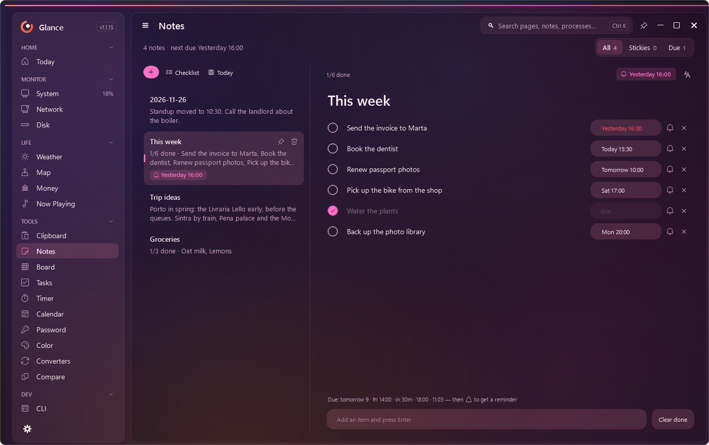
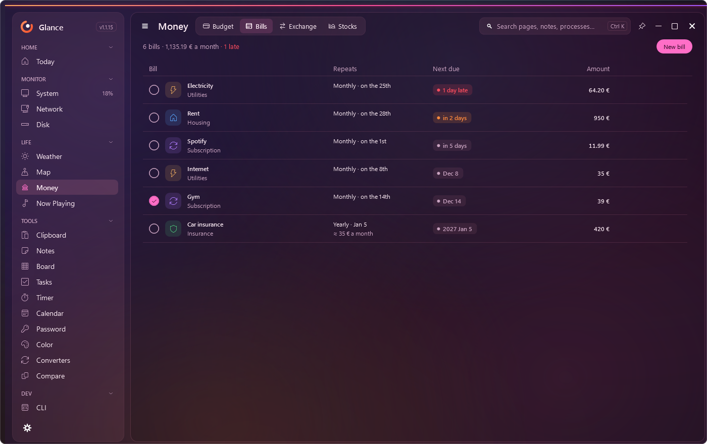
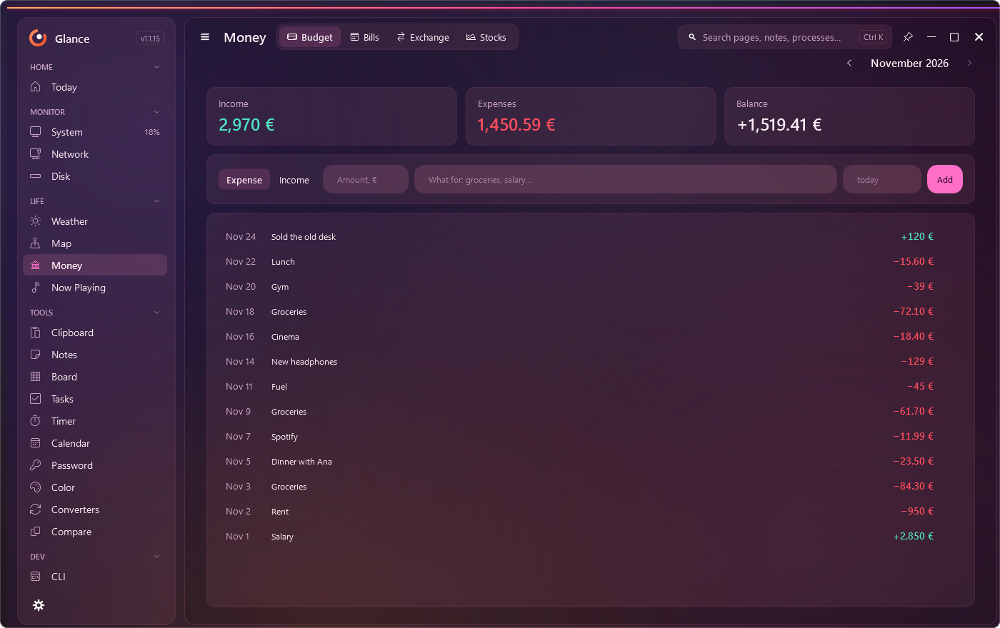
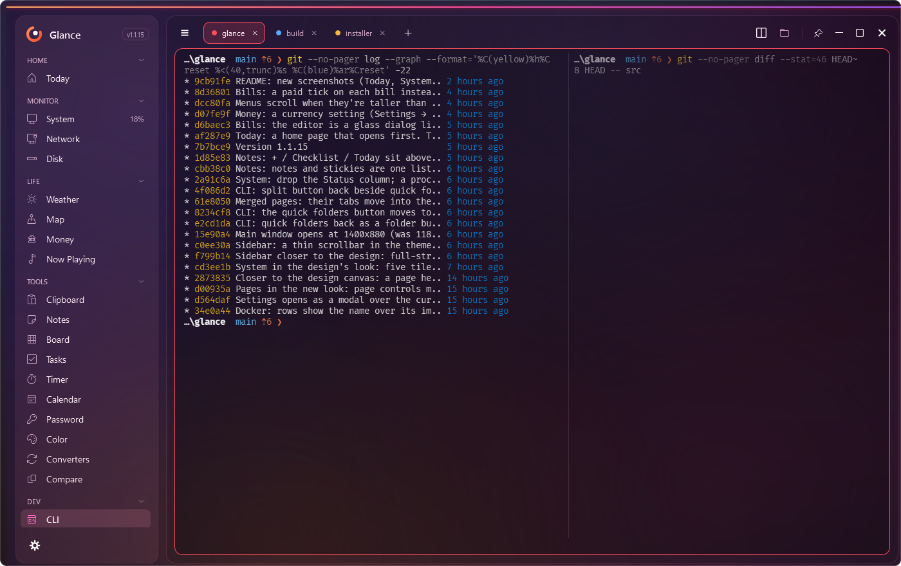

# Glance

A glassy Windows 11 tray dashboard: system stats, everyday tools and a terminal in one window.



## What's inside

- **Today**: the home page. The week's due tasks, calendar events and bills (late, today, then by day), what's next, what you've spent this month, the weather and today's note
- **Monitor**: live CPU, GPU, memory, network and disk with a process table; history, and an analysis of which apps strain the PC (with Windows' reliability and error reports); a network page with a speed test; disk cleanup and a disk usage scan
- **Life**: weather, map, now playing, and Money: a budget, bills with a paid tick that books them in the budget, exchange rates and stocks, all in the currency you pick
- **Tools**: clipboard history (text and images), notes and checklists that can sit on the desktop as stickies, a board (canvas and Kanban, Markdown, Obsidian canvas import/export), tasks gathered from notes and boards, timers, Google Calendar, password generator, color picker, image and media converters, file and folder compare
- **Dev**: a tabbed, split terminal (xterm.js + ConPTY) with quick folders, ports, Git, Docker, Cloudflare Workers and Pages, JSON viewer
- A Ctrl+K command palette, a mini window and a bar window, reminders, and it lives in the tray
- Two themes (Mint, Flamingo) with adjustable glass and glow; every page can be turned off in Settings → Pages

| | |
|---|---|
|  |  |
|  |  |



## Install

Download `Glance-x.y.z-setup.exe` from [Releases](https://github.com/dpatrik0610/glance/releases/latest) and run it (no admin needed). For a portable copy, unzip the `-win-x64.zip` instead. Glance updates itself.

Needs Windows 10/11 x64 (the glass look is best on 11), the [.NET 10 Desktop Runtime](https://dotnet.microsoft.com/download/dotnet/10.0) and WebView2.

## Build from source

```
dotnet build -c Release
```

Requires the .NET 10 SDK. Settings and notes are stored in `%APPDATA%\Glance`.

```
src/Glance/     the app
  Pages/        one page per sidebar entry
  Services/     system, network, storage and API access
  Windows/      secondary windows and dialogs
  Controls/     custom-drawn controls (gauges, sparklines, treemap)
  Themes/       styles and animations
  Terminal/     xterm.js host for the CLI page
  Map/          Leaflet host for the Map page
installer/      Inno Setup script for the setup exe
tools/          build, deploy, release and signing scripts
docs/           screenshots
```

## License

Copyright (C) 2026 dpatrik0610

Glance is free software under the [GNU General Public License v3.0](LICENSE): you can use, study, change and share it, and anything you distribute that's built on it must be released under the same license, with its source.
